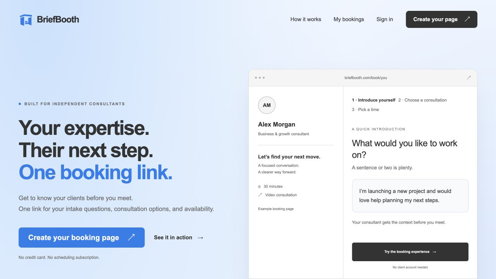
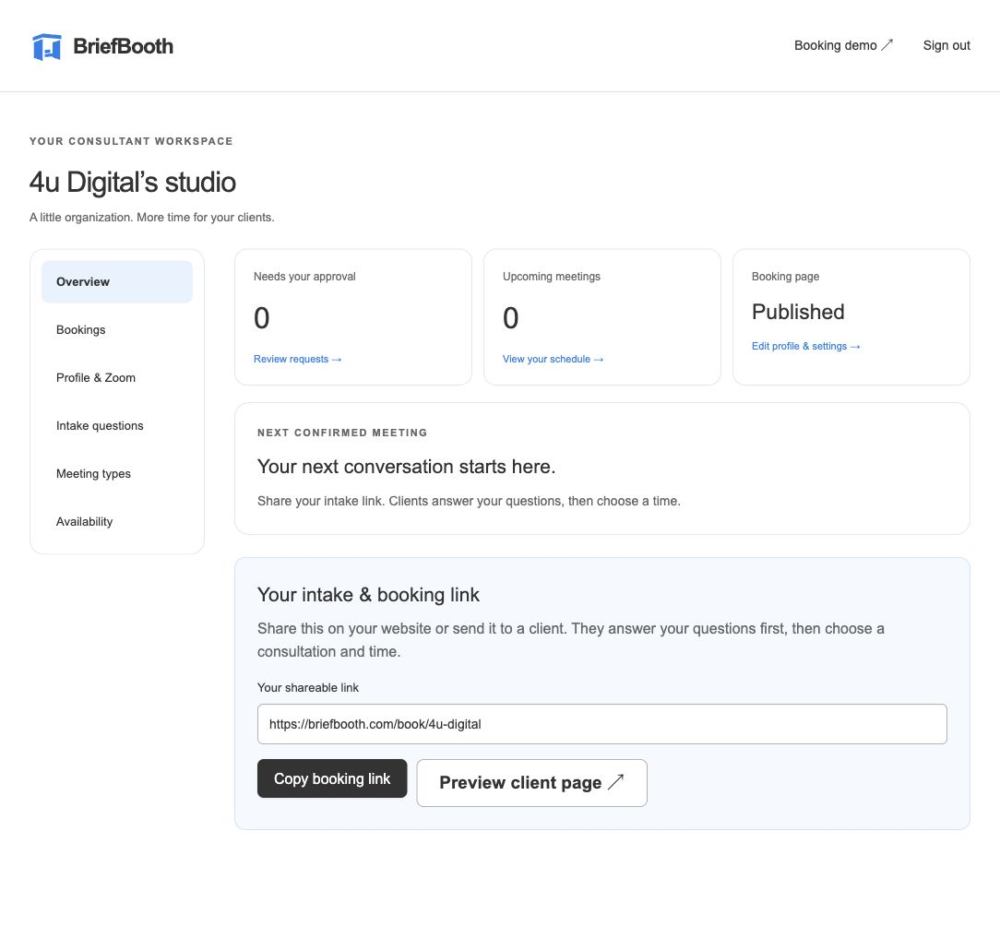
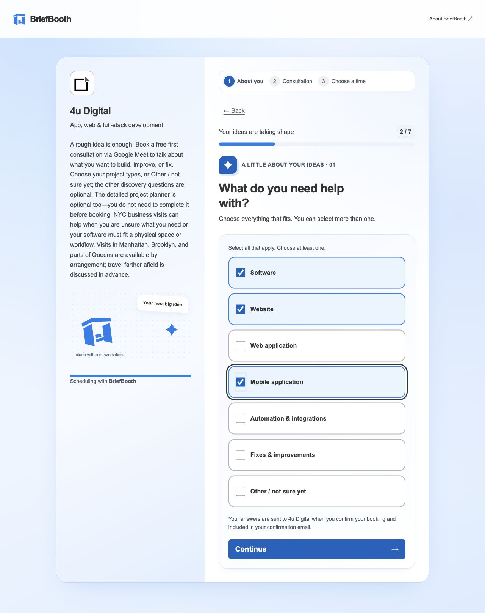
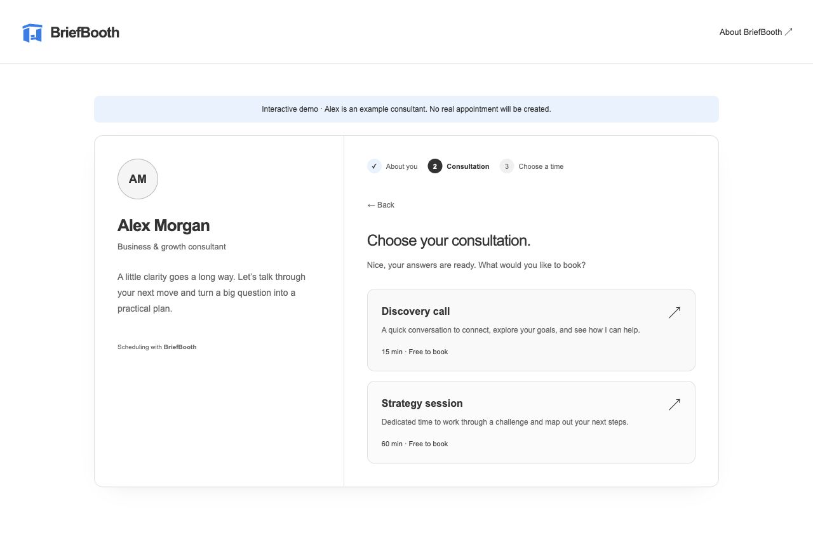
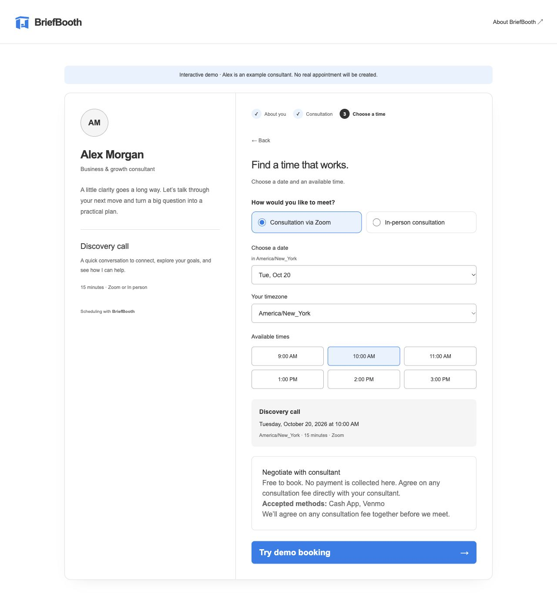
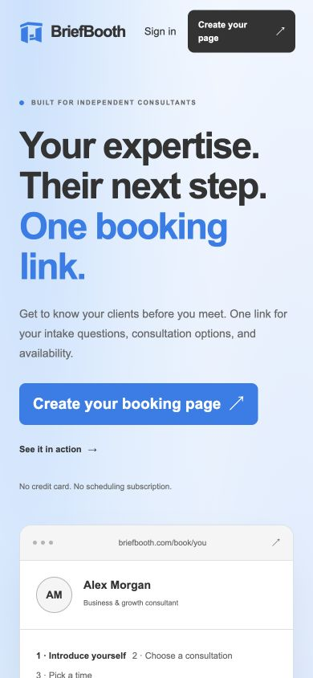
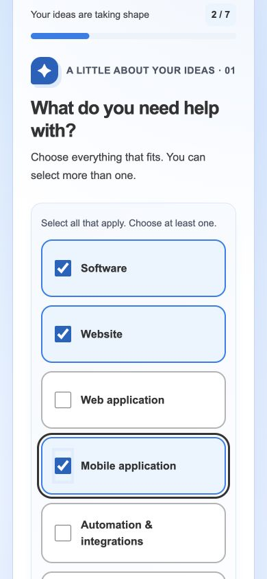
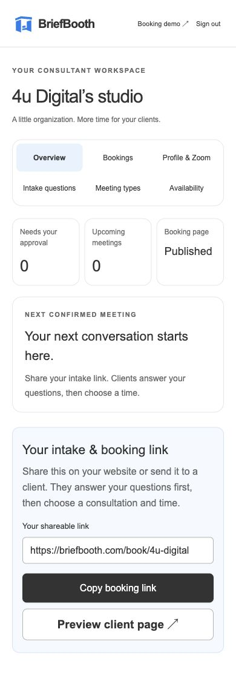
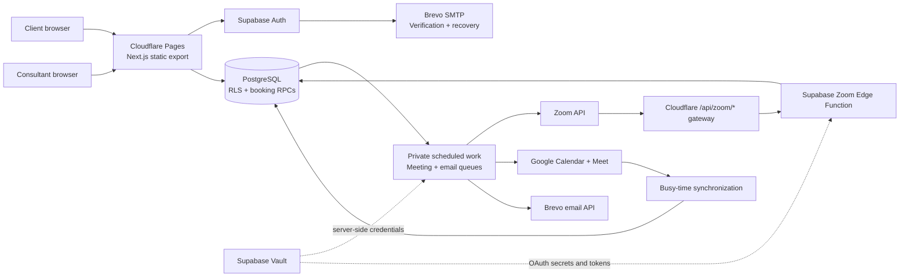
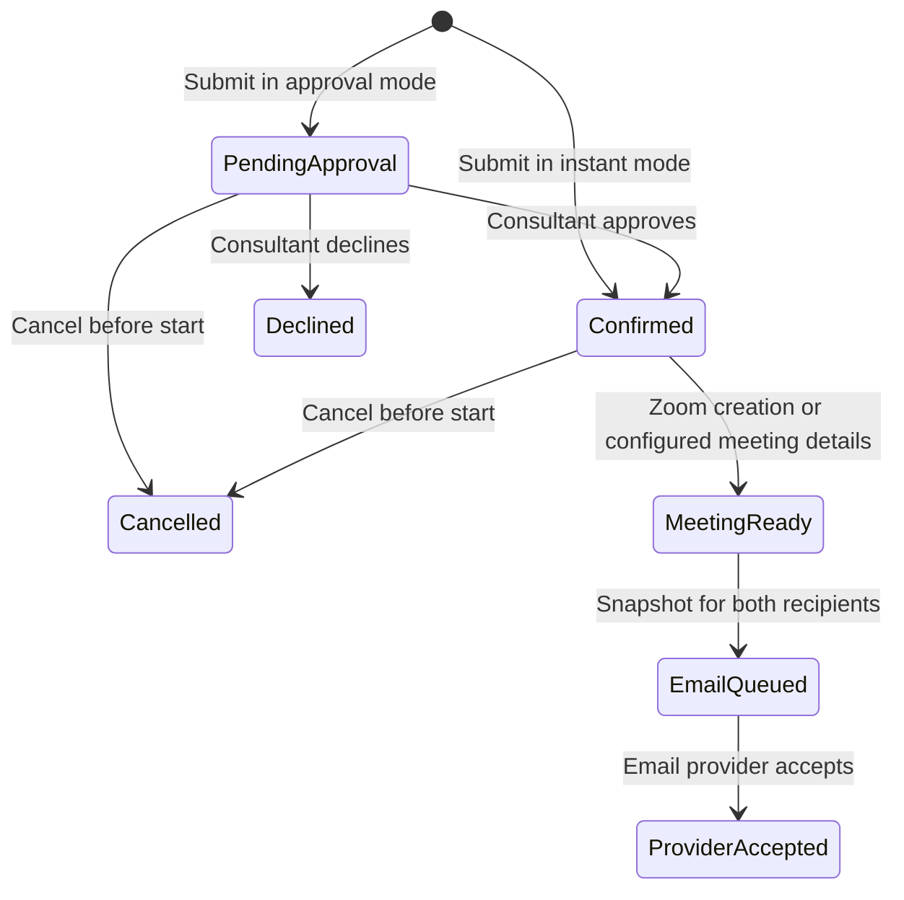

<div align="center">


# BriefBooth

### Your expertise. Their next step. One booking link.

An intake-first consultation platform that helps independent consultants arrive prepared—and helps clients book without creating an account.

**Next.js 16 · React 19 · TypeScript · PostgreSQL · Supabase · Cloudflare Pages**

[Live website](https://briefbooth.com) · [Interactive demo](https://briefbooth.com/book/demo/) · [Video walkthrough](docs/media/briefbooth-walkthrough.mp4) · [Technical deep dive](#engineering-decisions)



</div>

## The problem

A calendar invitation rarely explains what a client actually needs. Consultants often piece together context from emails, messages, and follow-up questions before the meeting can become useful.

BriefBooth puts that context **before scheduling**. A consultant shares one personal link. The client answers a short questionnaire, chooses a consultation, and requests or books an available time. The consultant reviews the same intake alongside the appointment, and both parties receive the relevant meeting details by email.

The product was built around a concrete constraint: use free service tiers, without requiring a paid scheduling subscription or payment processing to complete a booking.

## See it in action

**Fresh live captures · October 24, 2026.** Desktop and phone views below show the current public interface. The captioned video is an October 19 product walkthrough; it documents the earlier visual design and remains useful for understanding the booking sequence.

[](docs/media/briefbooth-walkthrough.mp4)

**[Watch or download the 30-second walkthrough →](docs/media/briefbooth-walkthrough.mp4)**

The silent, captioned video presents actual application screenshots: homepage → intake → consultation selection → scheduling → demo completion → consultant studio. It is an edited screenshot walkthrough, not a continuous screen recording. The client sequence uses the built-in demo and fictional information; it creates no real appointment or email. See the [text transcript](docs/media/WALKTHROUGH.md).

Prefer to interact? **[Try the account-free demo](https://briefbooth.com/book/demo/)**. No signup, payment, or live booking is needed.

## Product experience

### For consultants

- **A personal booking page:** publish a profile, small avatar, introduction, and shareable `/book/your-name` link.
- **Editable intake:** choose a specialty template, customize up to 10 questions, reorder them, and decide which answers are required.
- **Flexible consultations:** offer different durations with Google Meet, Zoom, or in-person meeting details. Automatic provider connections depend on authorization and provider approval.
- **Control over confirmations:** allow instant booking or require approval after reviewing the intake.
- **A focused studio:** overview metrics, next confirmed meeting, one-click link copying, searchable bookings, approval filters, and history.
- **Availability controls:** timezone-aware weekly hours, notice periods, buffers, days off, date-specific hours, and a bounded booking horizon. Connected Google Calendar busy intervals block conflicts.
- **Payment choices:** keep consultations free, publish external payment preferences, or complete Stripe onboarding for priced services. Live Stripe checkout is not yet verified end to end; see release boundaries below.
- **Follow-through:** reminders, cancellation notifications, private notes, outcomes, and an optional project planner keep the next step visible.

### For clients

1. Open the consultant’s link—no account required.
2. Answer one question at a time. Go back or skip optional questions.
3. Choose a consultation, meeting format, and available time in a selected timezone.
4. Submit a booking or approval request.
5. Receive confirmation details when confirmed, with a private management link and calendar download.
6. Optionally sign in by email to track requests, view meeting details, and edit intake answers. Changed answers notify the consultant.
7. Reschedule or cancel through the booking controls; rescheduled requests return for approval.

Client and consultant roles are enforced on the server. A client account cannot create a consultant profile by changing editable account metadata.

### Desktop app views

**Multi-select project intake.** Clients can choose software, websites, mobile applications, or several types together. The remaining discovery questions can be optional.



| Consultation selection | Scheduling |
| --- | --- |
|  |  |

**Consultant workspace** — overview, booking navigation and a shareable link. This studio capture and the demo screens above are from October 19; the current release adds further controls described below.


### Phone views

| Public homepage · October 24 | Project intake · October 24 | Studio · October 19 |
| --- | --- | --- |
|  |  |  |

Screenshots are real browser captures, not device mockups. The current intake capture uses fictional client information and stops before submission: no appointment, email, or charge was created. See [media provenance and video transcript](docs/media/WALKTHROUGH.md).

The booth-shaped brand mark represents a space for a focused consultation. Reusable [blue](public/brand/booth.svg) and [white](public/brand/booth-white.svg) SVG assets share the same geometry as the application header and favicon.

The interface uses a restrained blue-and-gray palette (`#137FEC`, `#333333`, `#676767`, `#B4B4B4`), visible keyboard focus, semantic form controls, and responsive layouts. The intake flow uses progressive disclosure to avoid presenting a long form all at once. These are implemented accessibility practices, not a claim of formal accessibility certification.

## Engineering decisions

The most substantial work is in the behavior behind the interface: keeping bookings consistent, separating tenants, coordinating external services, and making failure states explicit.

| Challenge | Implementation | Why it matters |
| --- | --- | --- |
| Two clients choose the same time | PostgreSQL booking constraints and server-side availability validation | A stale browser cannot override the authoritative schedule. |
| Consultants share a database | Row-level security, owner checks, and constrained public RPCs | Public booking access does not imply access to another consultant’s private records. |
| Intake changes after a client opens a page | Server validation of required answers and question IDs; stored answer snapshots | Stale questionnaires are rejected and historical bookings keep their original context. |
| A request needs approval | A pending booking reserves the slot; owner-only review changes its state | Approval is part of the domain model, rather than a visual badge on an already-confirmed meeting. |
| Zoom is slower than booking | Private scheduled work creates the meeting; confirmation email waits for the link | Clients should not receive an incomplete Zoom confirmation. |
| Network retries could duplicate work | Booking replay protection, queue deduplication, and provider idempotency where supported | Retries do not blindly create extra notifications or meetings. |
| An email provider times out ambiguously | Uncertain outcomes are held for review rather than automatically resent | The system distinguishes a known failure from an unknown result. |
| Arbitrary booking URLs on static hosting | Exported route shells and Cloudflare rewrites | Consultants can create new links without rebuilding one page per consultant. |
| OAuth needs a verified public domain | A narrowly scoped Pages Worker forwards only the Zoom callback/deauthorization routes | The main application stays static; the gateway does not forward browser credentials upstream. |
| Strict free-tier hosting | Static frontend, managed authentication/database, and bounded background work | No always-on application server or paid scheduling dependency is required by the current configuration. |

### Architecture



**Trust boundary:** browser configuration contains only public Supabase connection values. Provider credentials and Zoom tokens stay on the server side. Public booking operations validate input and expose a limited API instead of opening private tables to anonymous clients.

### Booking lifecycle



This is a conceptual workflow: `MeetingReady`, `EmailQueued`, and `ProviderAccepted` describe background processing, not additional values of the booking’s status column. Provider acceptance is **not** proof of inbox delivery. Cancellation and past-appointment checks guard background processing; already-created Zoom meetings currently require manual removal.

### Security and privacy

- Authenticated owner checks protect profile edits, availability, request review, and consultant data.
- PostgreSQL RLS isolates tenants; public RPCs deliberately expose only supported booking operations.
- Meeting URLs, addresses, and client intake are handled as private booking details.
- OAuth state is expiring, single-use, consultant-bound, and environment-bound.
- Zoom webhook handling verifies signatures, timestamps, and app identity before processing revocation.
- Development and production Zoom credentials remain separate to preserve existing connections during rollout.
- Avatar uploads are restricted to small supported raster images and converted to bounded WebP output; SVG and arbitrary remote URLs are rejected.
- Management links are bearer capabilities: anyone holding the token can access the permitted booking actions. They must remain private.
- Input validation, a honeypot, and booking rate limits provide basic abuse controls. Stronger bot protection remains a public-scale improvement.

## Verification

See the [end-to-end release evidence](docs/END-TO-END-RELEASE.md), [client account and intake checks](docs/CLIENT-ACCOUNTS-AND-INTAKE.md), and [earlier QA report](docs/QA-2026-10-19.md). These distinguish automated assertions, observed live behavior, and unverified provider boundaries.

```sh
npm run lint
npm test
npm run build
```

`npm test` runs the core domain suites; `npm run test:pages` separately checks hosting. The table highlights representative suites. Database suites execute SQL using **PGlite**, with local stubs for infrastructure such as cron/Vault/provider calls. They verify application rules without contacting paid services; they do not substitute for a live provider integration test.

| Suite | Representative checks |
| --- | --- |
| [Database and email](tests/database.mjs) | Overlap prevention, timezone/DST behavior, tenant isolation, required intake, snapshots, cancellation, retry handling |
| [Payment boundaries](tests/payments.mjs) | Payment-state boundaries, fee calculations, publishing gates and direct payment preferences |
| [Zoom and approvals](tests/zoom.mjs) | Owner-only review, pending slot holds, no Zoom before approval, OAuth replay protection, environment isolation |
| [Zoom webhook](tests/zoom-webhook.mjs) | Signed challenge, invalid/stale requests, identity checks, fail-closed responses |
| [Zoom gateway](tests/zoom-gateway.mjs) | Fixed upstream, method/body limits, unchanged signed payload, no credential forwarding |
| [Avatars](tests/avatar.mjs) | Size/type constraints, valid WebP, removal, rejection of SVG/remote URLs |
| [Google provider](tests/google-provider.mjs) | Calendar/Meet processing, approval timing and provider failure handling |
| [Calendar feeds](tests/calendar-feed.mjs) | Private subscription access and feed behavior |
| [Planner email](tests/project-planner-email.mjs) | Planner notification eligibility and worker behavior |
| [Pages deployment](tests/pages.mjs) | Deep links, exported assets, security headers, private-page cache/index behavior, genuine 404s |

For a deployed build or a running Pages preview:

```sh
PAGES_TEST_URL=https://your-project.pages.dev npm run test:pages
```

A separate [browser smoke script](tests/browser.mjs) is also available; it is not part of `npm test` and requires a browser runtime. Recent manual checks covered the public demo and authenticated studio navigation, search, refresh, and a 390px-wide mobile layout. The executable suites above make the behavior checks reproducible.

## Run locally

**Prerequisites:** Node.js 22+, npm, and a Supabase project for real account/booking flows. The public demo is designed to work without creating records.

```sh
git clone https://github.com/taylordrew4u2/BriefBooth.com.git
cd BriefBooth.com
# Current application work is on this branch until merged:
git checkout codex/briefbooth-booking
npm ci
cp .env.example .env.local
npm run dev
```

Set these public values in `.env.local` to enable real account and booking operations:

```dotenv
NEXT_PUBLIC_SUPABASE_URL=https://your-project.supabase.co
NEXT_PUBLIC_SUPABASE_PUBLISHABLE_KEY=your-publishable-key
NEXT_PUBLIC_GOOGLE_AUTH_ENABLED=false
```

Never put a service-role key, SMTP password, Brevo key, or Zoom client secret in a `NEXT_PUBLIC_` variable.

For Cloudflare’s production-style route rewrites:

```sh
npm run build
npm start
# In another terminal:
npm run test:pages
```

`npm start` serves the exported `out` directory through Wrangler on port 3000. Next.js development and static-host rewrites are different environments; test arbitrary consultant and management links in the Pages preview.

**Backend provisioning is separate from starting the frontend.** Begin with the base schema only for a new empty database, apply dated migrations in order, configure private workers, authentication redirects, and email credentials, and deploy the Zoom function if needed. Do not rerun the base schema on a populated environment. See [operations and deployment](docs/OPERATIONS.md).

## Repository map

```text
app/                         Public pages, account flow, consultant studio
components/                  Booking, management, intake, avatar, Zoom UI
lib/                         Typed database client and domain utilities
supabase/schema.sql          Base database schema
supabase/migrations/         Versioned booking, intake, email, Zoom changes
supabase/functions/zoom/     OAuth and signed deauthorization handling
supabase/booking-email-worker.sql
                             Private email worker setup
scripts/prepare-pages.mjs    Exported route shells and Worker packaging
scripts/zoom-gateway.js      Narrow public-domain Zoom proxy
tests/                      Executable domain and deployment checks
docs/                       Operations, screenshots, video, transcript
```

## Current release and honest boundaries

Status documented **October 24, 2026**, based on the linked release records. Screenshots are not evidence of provider approval.

| Capability | Status |
| --- | --- |
| Consultant accounts, profiles, shareable links, intake templates, scheduling | Implemented and deployed |
| Client email-link login, booking status and editable intake | Implemented; verified-email ownership enforced |
| Instant bookings, approval requests, rescheduling and cancellation | Implemented; live disposable booking checks documented |
| Confirmation, reminder, cancellation and changed-intake email queues | Implemented; delivery subject to provider availability and free-tier quotas |
| Google Calendar busy-time checks and Google Meet after approval | Working for the authorized account; public Calendar scope review is **not submitted or approved** |
| Zoom | Existing authorized connection works; public consultant rollout awaits Zoom approval |
| Apple/Outlook calendars | Private one-way subscription feeds; no busy-time import or full two-way sync |
| Stripe | Live server integration and embedded onboarding deployed; consultant merchant onboarding and actual checkout remain unverified; no real test charge made |
| Schedule overrides, notes/outcomes, private export and guarded account deletion | Implemented; deletion of accounts with paid records requires support review |
| Zoom meeting deletion | Manual cleanup remains necessary for existing scope permissions |

[Google setup](docs/GOOGLE-CALENDAR-SETUP.md) · [Zoom rollout](ZOOM-PUBLIC-RELEASE.md) · [Stripe activation](docs/STRIPE-ACTIVATION.md) · [Release evidence](docs/END-TO-END-RELEASE.md)

The current deployment uses **Cloudflare Pages Free, Supabase Free, and Brevo Free**, plus the connected Zoom account. Free-tier quotas still apply; this is not a promise of unlimited free infrastructure. No automatic paid fallback is configured. The owned custom domain is separate from hosting. The existing Vercel project is paused and is not the active deployment path.

## What this project demonstrates

BriefBooth combines product design with full-stack implementation: translating a real consultation workflow into a small interface, modeling approval and cancellation states, enforcing correctness in PostgreSQL, protecting tenant boundaries, integrating OAuth and asynchronous notifications, and deploying within explicit cost constraints.

Remaining priorities are Google scope verification, broader Zoom authorization after review, completing merchant onboarding and payment verification, and stronger operational monitoring and abuse prevention. The product demo does not imply that these external approval steps are complete.

---

Built for **4u Digital**. [Product support](https://briefbooth.com/support/) · [4u Digital](https://customtechbuilt4u.com)
